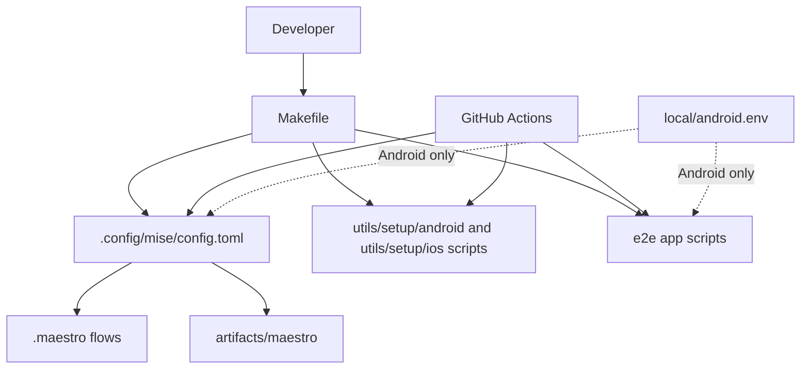
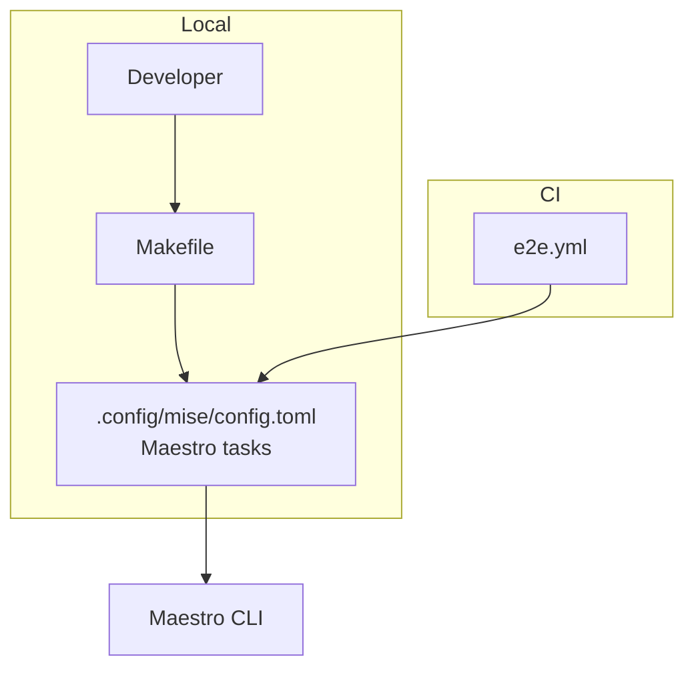
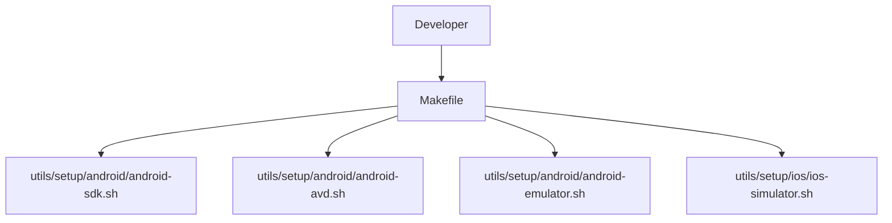
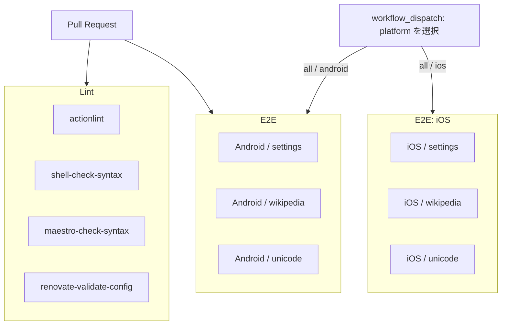
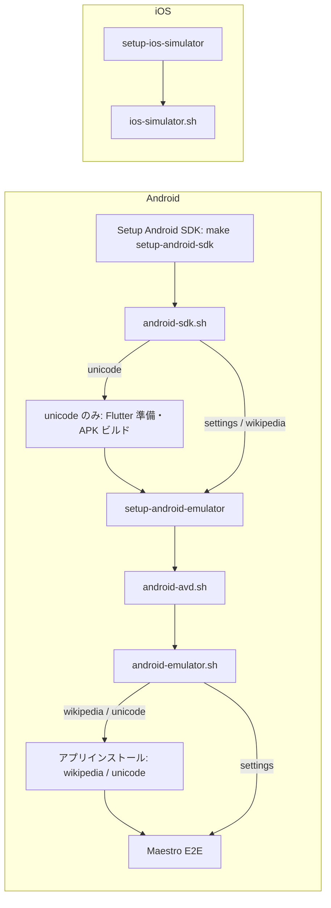
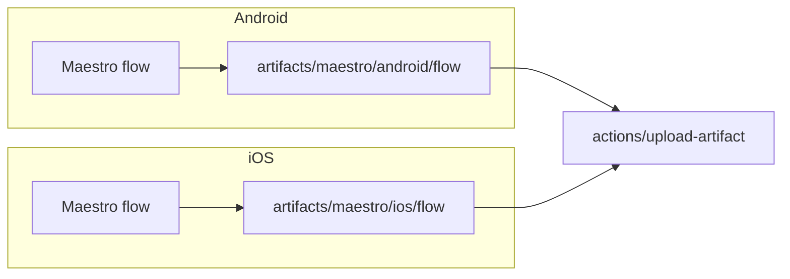

# Architecture

## Repository Overview

ローカルと CI で同じバージョンの `maestro-cli` を使用し、Maestro の実行とテスト環境のセットアップで同じ処理を利用できる構成にしています。

Maestro の実行コマンドや引数は [.config/mise/config.toml](../.config/mise/config.toml) の task にまとめています。

ローカルでは Makefile を入口として mise task やセットアップスクリプトを呼び出し、CI では GitHub Actions から直接呼び出します。

Android Emulator / iOS Simulator のセットアップ処理の実体は [.config/mise/config.toml](../.config/mise/config.toml) や [Makefile](../Makefile) には含めず、[utils/setup/](../utils/setup/) のスクリプトにまとめています。ローカルでは Makefile の target からそれらのスクリプトを呼び出します。

> [!NOTE]
> iOS の実行は macOS 環境が必要です（Linux / Windows / WSL では非対応）。CI では GitHub Actions (macOS runner) を使用します。

## Using mise Tasks in Local and CI

Maestro の実行コマンドや引数は [.config/mise/config.toml](../.config/mise/config.toml) の task にまとめています。

ローカルでは [Makefile](../Makefile) をラッパーとして使い、用途ごとの target から mise task を呼び出します。

CI では [e2e.yml](../.github/workflows/e2e.yml) から mise task を直接実行し、flow などの値は job や matrix から渡します。

## Runtime Setup

セットアップ処理の実体は [utils/setup/android/](../utils/setup/android/) と [utils/setup/ios/](../utils/setup/ios/) に置きます。

ローカルでは [Makefile](../Makefile) の target を入口にします。

## CI

Pull Request では、`Lint` と `E2E` の workflow を実行します。

### Workflows

`Lint` では workflow、shell script、Maestro flow などの構文を確認します。

PR の `E2E` は Android の3フローを実行します。iOS は `workflow_dispatch` のみで実行し、`platform` が `ios` または `all` の場合に3フローを実行します。Android は手動実行でも `android` または `all` を選ぶと実行されます。ロケールは PR では `ja`、手動実行では `locale` 入力（既定値 `ja`）です。

### Runtime Setup in CI

Android SDK のインストールは `setup-android-emulator` composite action から独立したステップです。`android-sdk.sh` が Platform 36 と API 36 の `google_apis;x86_64` system image を用意し、`unicode` の場合だけ `NDK_VERSION=28.2.13676358` で NDK もインストールします。SDK コマンドには同じ `--sdk_root` を渡し、`ANDROID_HOME` / `ANDROID_SDK_ROOT` と SDK の `PATH` を後続ステップに引き継ぎます。

`unicode` は Java 17.0.21+9 を準備し、SDK / NDK セットアップ後に Flutter 3.38.5 を用意して `make build-demo-app` で APK をビルドします。その後、composite action が `android-avd.sh` と `android-emulator.sh` を順に呼び出します。起動後に APK をインストールして Maestro を実行します。`wikipedia` は配布済み APK を取得・インストールし、`settings` は OS 標準アプリを使用します。

iOS の `unicode` は Flutter デモアプリを Simulator 向けにビルドしてから `setup-ios-simulator` を実行し、アプリのインストール後に Maestro を実行します。iOS のセットアップは従来どおり composite action が `ios-simulator.sh` を呼び出します。

### Artifacts

Maestro のテスト結果は `artifacts/maestro/<platform>/<flow>` に出力し、CI では `actions/upload-artifact` を使って保存します。

ローカルでのセットアップやテストの実行方法については [DEVELOPMENT.md](./DEVELOPMENT.md) を参照します。
