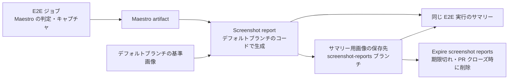

# GitHub Actions

## CI

PR では `Lint` を実行します。`Test` と `E2E` は `docs/**` と Markdown ファイルだけを変更した PR では起動しません。

`Lint` では workflow、shell script、Maestro flow などの構文を確認します。

`Test` ではスクリーンショットレポート生成処理の Python 単体テストを実行します。対象ファイルを変更した PR、`main` への push、手動実行で起動します。

PR の `E2E` では、Android 17 と iOS 27.0（iPhone 18 Pro）で `unicode` を日本語・英語で実行します（4ジョブ）。週次実行は月曜 05:23（日本時間）に Android 16/17 と iOS 26/27 を日本語・英語で検証します（8ジョブ）。手動実行（`workflow_dispatch`）の既定は Android 17 と iOS 27 の日本語です。`platform` に `all` / `android` / `ios` を指定すると、選択したプラットフォームで `settings` / `wikipedia` / `unicode` の3フローを実行します。`ios_configuration` では iOS 27.0 または iOS 26.2（iPhone 17 Pro）を選べます。どちらも日本語（`ja`）と英語（`en`）に対応します。

Maestro CLI のバージョン、Emulator / Simulator の設定、Settings / Wikipedia のフロー、アプリのダウンロード・インストール処理を変更した場合は、マージ前に同じブランチから `platform: all` で手動実行し、全6フローの成功を確認します。

CI の構成については [ARCHITECTURE.md](./ARCHITECTURE.md) の `CI` を参照してください。

Maestro のテスト結果はローカルと同じ `artifacts/maestro/<platform>/<flow>` に出力します。CI での保存方法については [ARCHITECTURE.md](./ARCHITECTURE.md) の `Artifacts` を参照してください。

## Flutter の更新 PR

Renovate は mise の標準対応を使い、Flutter の安定版バージョンと lockfile を同時に更新します。Flutter の自動マージは無効です。

Flutter の更新 PR でも、Android / iOS の `unicode` を自動実行します。両 OS の成功を確認してからマージします。Flutter の更新に伴って必要な SDK / NDK が変わった場合は、その PR で設定も調整します。

手動実行では `android_configuration` で Android 17（API `37.0`、`google_apis_ps16k`）または Android 16（API `36`、`google_apis`）を選びます。どちらも日本語（`ja`）と英語（`en`）に対応します。アプリのビルドにはどちらも compile SDK 36 を使います。Emulator 本体の固定と Renovate による管理は、別の PR で扱います。

## Unicode フローの画像比較

日本語の基準画像は [Android 16 CI 実行 #41563686593](https://github.com/gkzz/maestro-playground/actions/runs/41563686593) と
[iOS 26 CI 実行 #41559360999](https://github.com/gkzz/maestro-playground/actions/runs/41559360999) のキャプチャから作成しました。
CI の `unicode` ジョブは、OS バージョンとロケールに対応する基準画像を使います。PR と週次実行では基準画像が必須です。手動実行で対応する画像がない場合は撮影のみを行います。基準画像の作成手順は [開発ガイド](DEVELOPMENT.md) を参照してください。
CI では、既存の Emulator / Simulator のセットアップで `E2E_LOCALE` を適用します。
ローカルでのキャプチャと比較の手順は [DEVELOPMENT.md](./DEVELOPMENT.md) を参照してください。

## 画像比較サマリー

現在、`Screenshot report` workflow の呼び出しはコメントアウトしています。再利用 workflow の `@main` 参照は `actions.lock` の固定対象外のため、サマリーの生成と画像公開を停止しています。[#41](https://github.com/gkzz/maestro-playground/issues/41) で保存方式と関連 workflow を再検討します。Maestro による画像比較と artifact の保存は継続します。以下は停止前の構成です。

同じリポジトリの PR と手動実行では、E2E のテストジョブが終わると、デフォルトブランチの `Screenshot report` workflow を呼び出します。サマリーは同じ E2E 実行内に生成します。

サマリーでは、OS・ロケールごとに次を確認できます。

- Maestro の `assertScreenshot` の判定結果
- 基準画像（Baseline）と今回の入力欄（Current）
- artifact にある場合は、Maestro の差分画像（Diff）
- 折りたたんで表示する画面全体のキャプチャ

基準画像がない場合は「未比較」、キャプチャがない場合は取得できなかった旨を表示します。スクリーンショットの合否は Maestro が判定し、Python による独自のピクセル比較は行いません。E2E の成否は元の Maestro ジョブで確認してください。

サマリーに表示する画像は、専用の `screenshot-reports` ブランチに保存します。サマリーは、このブランチの URL を参照します。実行から1日経過した画像は、定期実行の `Expire screenshot reports` workflow がブランチから削除します。PR がクローズされた場合は、その PR の E2E 実行で作られた画像を早めに削除します。

Maestro の artifact と比較レポートの artifact も `retention-days: 1` に設定しています。定期実行が遅れることがあるため、画像が消える時刻は実行からちょうど24時間後とは限りません。期限切れの画像を除き、ブランチの履歴を作り直します。ただし、GitHub の内部キャッシュや到達不能な Git オブジェクトが物理的に削除される時刻は制御できません。

画像の公開と削除を行う専用ジョブには、`contents: write` を付与します。PR の E2E ジョブには書き込み権限を付与しません。公開ジョブはデフォルトブランチのコードを実行します。fork からの PR では画像公開ジョブを実行せず、通常の Maestro artifact を使用します。

Android で Maestro の実行開始時に、`deviceInfo` の取得中にデバイスサーバーが切断された場合、CI は1回だけ再実行します。初回の `maestro.log` は `maestro-first-attempt.log` として artifact に残します。
画像の不一致や他のテスト失敗では再実行しません。
