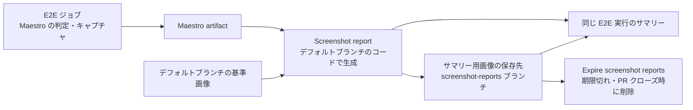

# GitHub Actions

## CI

PR では `Lint` を実行します。`Test` と `E2E` は `docs/**` と Markdown ファイルだけを変更した PR では起動しません。

`Lint` では workflow、shell script、Maestro flow などの構文を確認します。

`Test` ではスクリーンショットレポート生成処理の Python 単体テストを実行します。対象ファイルを変更した PR、`main` への push、手動実行で起動します。

PR の `E2E` では、Android で `settings` / `wikipedia` / `unicode` の3フローを実行します。手動実行（`workflow_dispatch`）では、`platform` で Android または iOS を選び、選択したプラットフォームで同じ3フローを実行します。

CI の構成については [ARCHITECTURE.md](./ARCHITECTURE.md) の `CI` を参照してください。

Maestro のテスト結果はローカルと同じ `artifacts/maestro/<platform>/<flow>` に出力します。CI での保存方法については [ARCHITECTURE.md](./ARCHITECTURE.md) の `Artifacts` を参照してください。

## Flutter の更新 PR

Renovate は mise の標準対応を使い、Flutter の安定版バージョンと lockfile を同時に更新します。Flutter の自動マージは無効です。

更新 PR では、Android の3フローに加え、同じブランチから `workflow_dispatch` で `ios` を指定して実行します。iOS の3フローも成功したことを確認してからマージします。Flutter の更新に伴って必要な SDK / NDK が変わった場合は、その PR で設定も調整します。

Android API レベルはテスト対象として手動で選びます。Emulator 本体の固定と Renovate による管理は、別の PR で扱います。

## Unicode フローの画像比較

日本語の基準画像は [Android CI 実行 #41563686593](https://github.com/gkzz/maestro-playground/actions/runs/41563686593) と
[iOS CI 実行 #41559360999](https://github.com/gkzz/maestro-playground/actions/runs/41559360999) のキャプチャから作成しました。
基準画像をリポジトリに含めると、CI の Flutter（`unicode`）ジョブでも自動的に比較します。基準画像がない組み合わせでは、撮影のみ行います。
CI では、既存の Emulator / Simulator のセットアップで `E2E_LOCALE` を適用します。
ローカルでのキャプチャと比較の手順は [DEVELOPMENT.md](./DEVELOPMENT.md) を参照してください。

## 画像比較サマリー

同じリポジトリの PR と手動実行では、E2E のテストジョブが終わると、デフォルトブランチの `Screenshot report` workflow を呼び出します。サマリーは同じ E2E 実行内に生成します。

サマリーでは、OS・ロケールごとに次を確認できます。

- Maestro の `assertScreenshot` の判定結果
- 基準画像（Baseline）と今回の入力欄（Current）
- artifact にある場合は、Maestro の差分画像（Diff）
- 折りたたんで表示する画面全体のキャプチャ

基準画像がない場合は「未比較」、キャプチャがない場合は取得できなかった旨を表示します。スクリーンショットの合否は Maestro が判定し、Python による独自のピクセル比較は行いません。E2E の成否は元の Maestro ジョブで確認してください。

サマリーに表示する画像は、専用の `screenshot-reports` ブランチに保存します。サマリーは、このブランチの URL を参照します。実行から1日経過した画像は、定期実行の `Expire screenshot reports` workflow がブランチから削除します。PR がクローズされた場合は、その PR の E2E 実行で作られた画像を早めに削除します。

Maestro の artifact と比較レポートの artifact も `retention-days: 1` に設定しています。定期実行が遅れることがあるため、画像が消える時刻は実行からちょうど24時間後とは限りません。期限切れの画像を除き、ブランチの履歴を作り直します。ただし、GitHub の内部キャッシュや到達不能な Git オブジェクトが物理的に削除される時刻は制御できません。

画像の公開と削除を行う専用ジョブには、`contents: write` を付与します。PR の E2E ジョブには書き込み権限を付与しません。公開ジョブはデフォルトブランチのコードを実行します。fork からの PR では画像公開ジョブを実行せず、通常の Maestro artifact を使用します。

Android で Maestro の実行開始時に、`deviceInfo` の取得中にデバイスサーバーが切断された場合、CI は1回だけ再実行します。初回の `maestro.log` は `maestro-first-attempt.log` として artifact に残します。
画像の不一致や他のテスト失敗では再実行しません。
