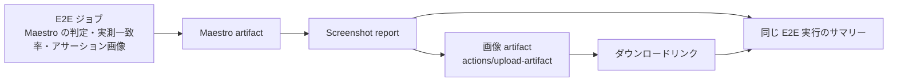

# GitHub Actions

## CI

PR では `Lint` を実行します。`Test` と `E2E` は `docs/**` と Markdown ファイルだけを変更した PR では起動しません。

`Lint` では workflow、shell script、Maestro flow などの構文を確認します。

`Test` ではスクリーンショットレポート生成処理の Python 単体テストを実行します。対象ファイルを変更した PR、`main` への push、手動実行で起動します。

PR の `E2E` では、Android で `settings` / `wikipedia` / `unicode` の3フローを実行します。手動実行（`workflow_dispatch`）では、`platform` で Android または iOS を選び、選択したプラットフォームで同じ3フローを実行します。

CI の構成については [ARCHITECTURE.md](./ARCHITECTURE.md) の `CI` を参照してください。

Maestro のテスト結果はローカルと同じ `artifacts/maestro/<platform>/<flow>` に出力します。CI での保存方法については [ARCHITECTURE.md](./ARCHITECTURE.md) の `Artifacts` を参照してください。

## Flutter の更新 PR

Renovate は mise の標準対応を使い、Flutter の安定版バージョンと lockfile を同時に更新します。Flutter の自動マージは無効です。

更新 PR では、Android の3フローに加え、同じブランチから `workflow_dispatch` で `ios` を指定して実行します。iOS の3フローも成功したことを確認してからマージします。Flutter の更新に伴って必要な SDK / NDK が変わった場合は、その PR で設定も調整します。

Android API レベルはテスト対象として手動で選びます。Emulator 本体の固定と Renovate による管理は、別の PR で扱います。

## Unicode フローの画像比較

日本語の基準画像は [Android CI 実行 #41563686593](https://github.com/gkzz/maestro-playground/actions/runs/41563686593) と
[iOS CI 実行 #41559360999](https://github.com/gkzz/maestro-playground/actions/runs/41559360999) のキャプチャから作成しました。
基準画像をリポジトリに含めると、CI の Flutter（`unicode`）ジョブでも自動的に比較します。基準画像がない組み合わせでは、撮影のみ行います。
CI では、既存の Emulator / Simulator のセットアップで `E2E_LOCALE` を適用します。
ローカルでのキャプチャと比較の手順は [DEVELOPMENT.md](./DEVELOPMENT.md) を参照してください。

## 画像比較サマリー

> WIP: 以下は移行後の仕様です。現在固定している公式 CLI 2.12.1 は、アサーション画像と実測一致率の出力に未対応です。必要な情報を出力する公式版の公開後、実際の出力形式に合わせてレポートを調整し、Android / iOS の E2E で検証してからマージします。

同じリポジトリの PR と手動実行では、E2E のテストジョブが終わると `Screenshot report` workflow を呼び出します。サマリーは同じ E2E 実行内に生成します。呼び出し元と同じリビジョンの workflow とコードを使うため、PR の変更もマージ前に検証できます。

サマリーには、OS・ロケールごとに各 `assertScreenshot` の判定結果、実測一致率、しきい値、画像のファイル名を表示します。リンク先の `screenshot-comparison-<locale>` artifact をダウンロードすると、アサーションで実際に使用した画像と、Maestro が生成した場合は差分画像を確認できます。画像はインライン表示しません。

一致率は Maestro の比較処理が返した値を使用します。Python では画像比較や合否判定を行いません。画像サイズが異なる場合は一致率を計算できないため、`N/A (image size mismatch)` と表示します。アサーションの失敗は元の E2E ジョブの失敗として扱います。

基準画像がない場合は「未比較」と表示します。結果ファイルや実測一致率、実際のアサーション画像を取得できない場合は、その旨をサマリーに残したうえでレポート Job を失敗させます。直前の `takeScreenshot` の画像をアサーション画像の代わりには使いません。

基準画像はアップロード対象から除外します。Maestro artifact と画像 artifact は `retention-days: 1` で保存し、保持期間の管理は GitHub Actions に任せます。ダウンロードには GitHub へのログインとリポジトリへのアクセス権が必要で、artifact の有効期限が切れるか、artifact または実行が削除されるとリンク先から取得できなくなります。

`screenshot-reports` ブランチへの画像公開、履歴の強制更新、期限切れ画像を削除する workflow は使用しません。画像保存のための `contents: write` も不要です。以前のブランチに保存された画像は、この変更だけでは削除されません。fork からの PR では引き続きレポート Job を実行せず、通常の Maestro artifact を使用します。

この WIP 実装では、`commands.json` の `metadata.screenshotComparison`（実測一致率、しきい値、実画像のパス、サイズ不一致の有無）を読み取ります。この形式はローカルで変更した Maestro との接続用で、公式の出力仕様として確定したものではありません。公式版の対応を待ち、配布元は公式のまま維持します。

Android で Maestro の実行開始時に、`deviceInfo` の取得中にデバイスサーバーが切断された場合、CI は1回だけ再実行します。初回の `maestro.log` は `maestro-first-attempt.log` として artifact に残します。
画像の不一致や他のテスト失敗では再実行しません。
